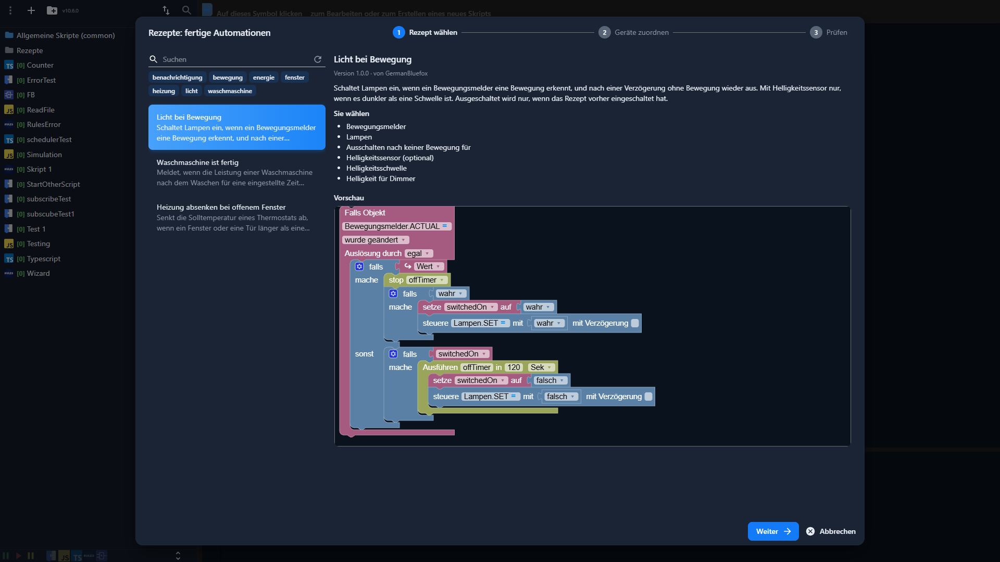
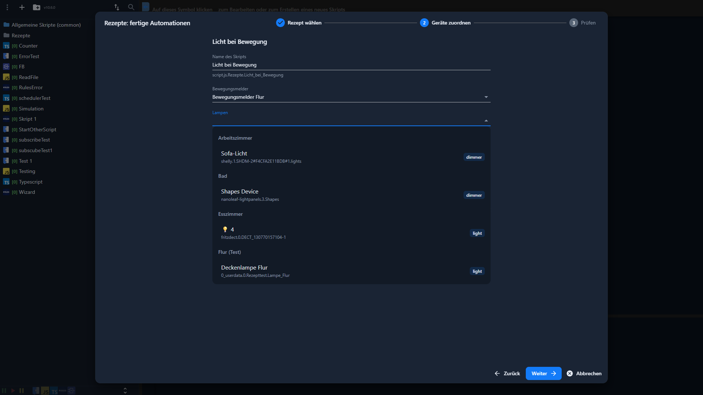
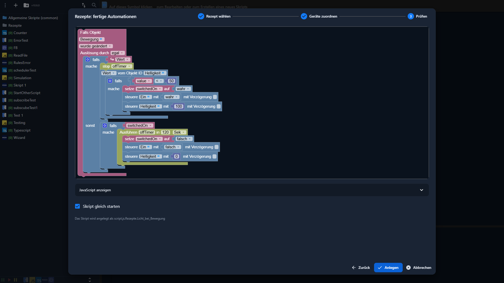
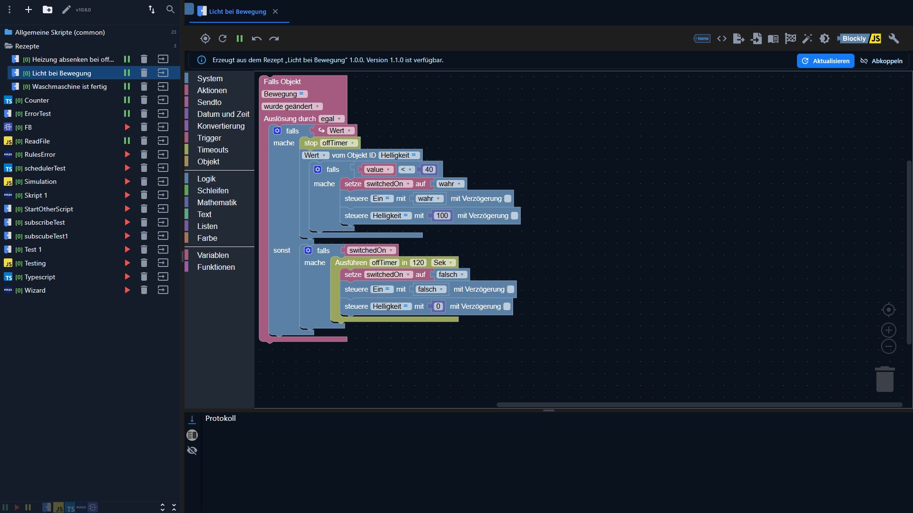
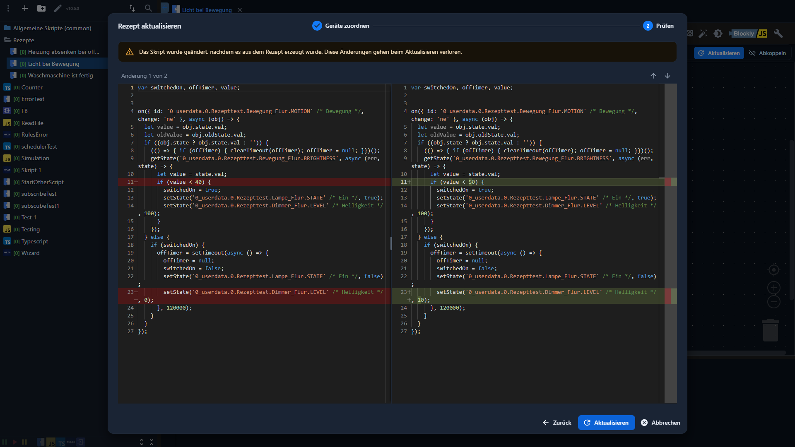
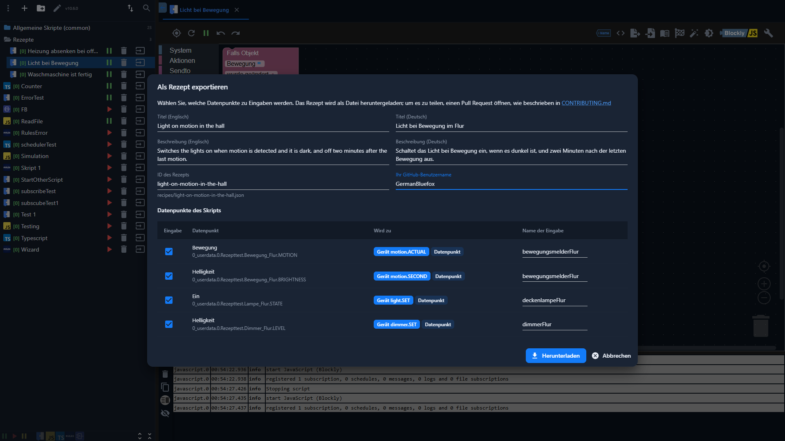

# Rezepte

Rezepte sind fertige Automationen aus dem Katalog [ioBroker.recipes](https://github.com/ioBroker/ioBroker.recipes):
ein Blockly-Skript mit Platzhaltern für die eigenen Geräte. Man wählt ein Rezept, ordnet die Geräte zu, und der Editor
legt daraus ein gewöhnliches Blockly-Skript an. Im Katalog gibt es nur Blockly, kein freies JavaScript.

## Ein Rezept anwenden

1. Ein neues Skript hinzufügen und oben **Rezepte ansehen** wählen.
2. **Rezept wählen**: Suche und Tags filtern die Liste. Rechts stehen die Beschreibung, die Eingaben und eine Vorschau
   der Blöcke.

    

3. **Geräte zuordnen**: Für eine Geräte-Eingabe bietet die Liste die passenden Geräte der Installation an, nach Räumen
   gruppiert. Erkannt werden sie mit dem Type-Detector, wie in den Gerätelisten von ioBroker. Für eine
   Datenpunkt-Eingabe öffnet sich die Objektauswahl, gefiltert nach passender Rolle und passendem Typ.

    

4. **Prüfen** zeigt die Blöcke und das JavaScript so, wie sie angelegt werden. **Anlegen** speichert das Skript im
   Ordner `Rezepte` und startet es auf Wunsch gleich.

    

Das Skript lässt sich danach wie jedes andere bearbeiten. In `common.recipe` merkt es sich, aus welchem Rezept und
welcher Version es stammt, die gewählten Geräte (nur ihre IDs) und Werte und einen Hash (SHA-256) des erzeugten
JavaScripts.

## Updates

Hat der Katalog eine neuere Version des Rezepts, zeigt der Editor über dem Skript einen Hinweis mit **Aktualisieren**.

Das Update erzeugt das Skript mit den gespeicherten Einstellungen neu:

- Eingaben, die die neue Version zusätzlich braucht, werden abgefragt;
- vor dem Speichern zeigt ein Vergleich, was sich ändert;
- wurde das Skript geändert, nachdem es aus dem Rezept erzeugt wurde (der Hash passt nicht mehr), warnt der Dialog,
  dass diese Änderungen verloren gehen.

**Abkoppeln** löst das Skript vom Rezept: Es bleibt, wie es ist, bekommt aber keine Updates mehr.

## Ein Skript als Rezept exportieren

Das Symbol **Als Rezept exportieren** in der Werkzeugleiste eines Blockly-Skripts listet die Datenpunkte des Skripts.
Für jeden wählt man, ob er zu einer Eingabe wird. Gehört er zu einem erkannten Gerät, schlägt der Dialog das Gerät mit
seinem Typ vor; sonst wird er eine Datenpunkt-Eingabe. Mit Titel und Beschreibung auf Englisch und Deutsch und dem
GitHub-Benutzernamen wird das Rezept als JSON-Datei heruntergeladen. Um es zu teilen, im Katalog einen Pull Request
öffnen, wie in [CONTRIBUTING.md](https://github.com/ioBroker/ioBroker.recipes/blob/main/CONTRIBUTING.md) beschrieben.

## Einstellungen

Die Adresse des Katalogs steht in den Einstellungen der Instanz unter **Katalog der Rezepte**; leer heißt: der
offizielle Katalog. Der Adapter hält den Katalog eine Stunde im Speicher und speichert die zuletzt geladene Fassung.
Ist der Katalog nicht erreichbar, zeigt der Editor diese Fassung. Rezepte, die eine neuere Version des
javascript-Adapters brauchen, werden ausgeblendet.
